  

I'm Nox, a Computer Science master's student at Georgia Tech, focusing on machine learning. I work on LLM agents, reinforcement learning, and tools for AI research. Away from the screen, I enjoy film photography, painting, and exploring historic sites.

[Personal website](https://noxyjzeng.github.io/myWeb/)

  

